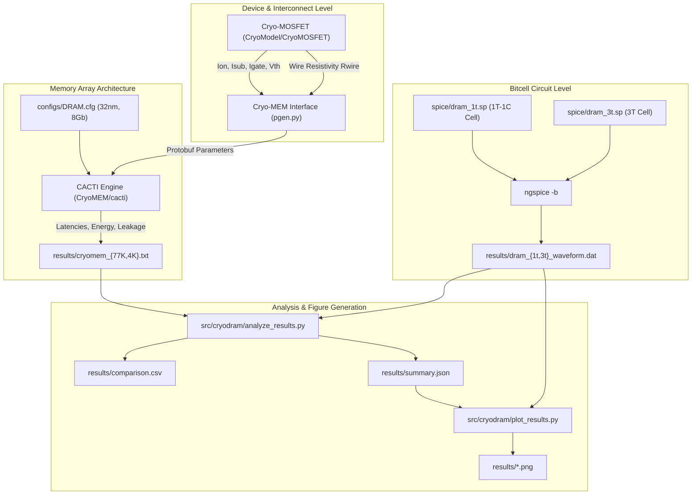

# Impacts of Extreme Low Temperatures on Silicon Physics and DIMM Operations by Evaluating Cryogenic DRAM

[](tests/)
[](pyproject.toml)
[](docs/troubleshooting.md)
[](LICENSE)

An end-to-end reproducible research repository combining **transistor-level dynamic RAM bitcell modeling (1T-1C & 3T)** with **architectural cryogenic performance modeling (77 K & 4 K)** for 32 nm DRAM main memory arrays, caches, and interconnects.

---

## 1. Project Overview

### 1.1 Research Question
How do deep cryogenic temperatures (77 K liquid nitrogen and 4 K liquid helium) impact nanoscale silicon MOSFET physics, copper wire interconnect resistivity, bitcell charge retention, and overall DIMM/memory-array latency, power, and energy?

### 1.2 Research Goals
- Quantify carrier mobility enhancements, subthreshold slope steepening, and leakage suppression at 77 K and 4 K.
- Model 8 Gb, 16-bank 32 nm DRAM main memory arrays to evaluate timing latencies ($t_{RCD}, t_{RAS}, t_{RC}, t_{CAS}, t_{RP}, t_{RRD}$) and energy components (activation, read, write, precharge).
- Simulate transistor-level 1T-1C and 3T DRAM bitcells to study write threshold-voltage loss ($V_{DD} - V_{th}$), charge sharing, and non-destructive sensing.
- Provide a push-button reproducible pipeline for student researchers and teammates using Windows 11 Pro (WSL 2) and native Ubuntu 22.04 LTS.

### 1.3 Cryogenic Semiconductor Behavior
At extreme low temperatures ($T \le 77\text{ K}$):
- **Phonon scattering** is dramatically suppressed, boosting carrier drift mobilities and saturation velocities, yielding higher transistor drive current ($I_{on}$).
- **Thermal voltage** $V_t = \frac{kT}{q}$ collapses from $25.9\text{ mV}$ (300 K) to $6.6\text{ mV}$ (77 K) and $0.34\text{ mV}$ (4 K). Consequently, subthreshold swing $SS = \ln(10) \frac{kT}{q} (1 + C_d/C_{ox})$ steepens, cutting subthreshold leakage ($I_{sub}$) by multiple orders of magnitude.
- **Copper resistivity** ($R_{wire}$) drops by $\approx 8\times$ due to reduced electron-phonon interactions.
- **Retention time** of dynamic capacitive storage nodes expands dramatically, enabling longer refresh intervals and reducing memory background power.

### 1.4 What This Project Demonstrates and Does Not Demonstrate
- **Demonstrates**: Software-modeled cryogenic transistor parameters, CACTI-modeled 32 nm DRAM array access latencies and leakage reductions, and SPICE transient charge-storage bitcell operation.
- **Does NOT Demonstrate**: Physical hardware measurements from a physical DIMM inside a dilution refrigerator.

---

## 2. Key Features

- **Cryo-MOSFET Generator**: Evaluates target NMOS/PMOS on-current, off-current, gate leakage, threshold voltage, and wire resistivity down to 4 K.
- **Cryo-MEM Array Modeling**: Interfaces cryogenic semiconductor parameters with CACTI to calculate bank-level timing, energy, leakage, and area.
- **SPICE Bitcell Transient Simulations**: 1T-1C and 3T bitcell simulations using ngspice with automated waveform export.
- **Automated Quantitative Analysis**: Parses simulation logs and waveforms, derives charge ($Q=CV$), energy ($CV^2$), and retention times, and writes [comparison.csv](file:///e:/CryoDRAM/results/comparison.csv) and [summary.json](file:///e:/CryoDRAM/results/summary.json).
- **Publication Figures**: Generates comparison plots with explicit labels, units, and methodological caveats.
- **Automated Verification Suite**: 13 unit, calculation, and output validation tests in `pytest`.

---

## 3. System Architecture



---

## 4. Prerequisites

### Tested Platforms
- **Windows 11 Pro with WSL 2** running **Ubuntu 22.04 LTS** (Primary student development environment).
- **Native Ubuntu 22.04 LTS**.

### System Packages & Compilers
- **Python**: 3.10.12 (Supported range: Python 3.8 to 3.10).
- **C++ Compiler**: `g++` (GCC 11.4+ with `-m64` support).
- **Build System**: GNU `make` (v4.3+).
- **SPICE Simulator**: `ngspice` (v36+).
- **Libraries**: `libboost-all-dev`, `libprotobuf-dev`, `protobuf-compiler`.
- **Python Packages**: `protobuf==3.20.3`, `numpy>=1.22.0`, `matplotlib>=3.5.0`, `pytest>=7.0.0`.

---

## 5. Installation & Setup

### 5.1 Setting Up Windows 11 with WSL 2 and Ubuntu 22.04 (From Scratch)

If you are on Windows 11 and do not have WSL 2 or Ubuntu installed yet, follow these step-by-step instructions:

#### Step 1: Ensure Hardware Virtualization is Enabled
1. Open **Task Manager** (`Ctrl + Shift + Esc`).
2. Click the **Performance** tab and select **CPU**.
3. Under the CPU graph, verify that **Virtualization: Enabled** is displayed.
   *(If disabled, reboot your PC, enter your BIOS/UEFI settings, and enable **Intel Virtualization Technology (VT-x)** or **AMD-V / SVM Mode**).*

#### Step 2: Install WSL 2 & Ubuntu 22.04
1. Press `Win + X` on your keyboard and select **Terminal (Admin)** or **PowerShell (Administrator)**.
2. Run the official WSL installation command:
   ```powershell
   wsl --install -d Ubuntu-22.04
   ```
3. If WSL is already installed or you encounter feature errors, ensure the required Windows features and WSL 2 kernel are up to date:
   ```powershell
   dism.exe /online /enable-feature /featurename:Microsoft-Windows-Subsystem-Linux /all /norestart
   dism.exe /online /enable-feature /featurename:VirtualMachinePlatform /all /norestart
   wsl --update
   wsl --set-default-version 2
   ```
4. **Restart your computer** if prompted by Windows to finalize virtualization setup.

#### Step 3: Initialize Ubuntu & Set Credentials
1. After rebooting, open **Ubuntu 22.04** from the Windows Start menu (or type `wsl -d Ubuntu-22.04` in PowerShell).
2. Wait a moment for the initial initialization to finish.
3. When prompted, create a **UNIX username** and **password** (note: characters will not show on screen while typing passwords for security).
4. Update the package database and install required system tools & libraries:
   ```bash
   sudo apt-get update && sudo apt-get install -y \
       build-essential g++ make ngspice python3-pip python3-venv \
       libboost-all-dev libprotobuf-dev protobuf-compiler
   ```

#### Step 4: Access Your Project Files in WSL
Windows drives are automatically accessible inside WSL under `/mnt/`:
- Windows `C:\` drive is at `/mnt/c/`
- Windows `E:\` drive is at `/mnt/e/`

You can navigate directly to your Windows repository or clone fresh:
```bash
# If your repository is located on your E: drive:
cd /mnt/e/CryoDRAM

# Or clone directly into your Linux user home directory:
cd ~
git clone https://github.com/Sonesh-2202/Cryogenic-Dram.git
cd Cryogenic-Dram
```

#### Step 5: Run Automated Project Setup
Inside the repository root in the Ubuntu terminal:
```bash
# 1. Run the automated setup script (creates .venv, installs packages, builds CACTI)
bash scripts/setup.sh

# 2. Activate the virtual environment
source .venv/bin/activate

# 3. Verify all tools and dependencies
make check
```

---

### 5.2 Native Ubuntu 22.04 LTS Setup
If you are already running native Ubuntu 22.04 LTS (or another Debian-based Linux distribution):
```bash
# 1. Install system tools and build libraries
sudo apt-get update && sudo apt-get install -y \
    build-essential g++ make ngspice python3-pip python3-venv \
    libboost-all-dev libprotobuf-dev protobuf-compiler

# 2. Clone and navigate to the repository
git clone https://github.com/Sonesh-2202/Cryogenic-Dram.git
cd Cryogenic-Dram

# 3. Run project setup and activate environment
bash scripts/setup.sh
source .venv/bin/activate
make check
```

---

## 6. Quick Start

Once the environment is active, reproduce the entire project with:

```bash
# 1. Verify dependencies
make check

# 2. Run all models, SPICE simulations, analysis, and plot generation
make all

# 3. Run automated verification test suite
make test
```

---

## 7. Individual Commands

Each module can be executed independently:

```bash
# Generate 77 K and 4 K CryoMOSFET device parameters
make run-mosfet
# Output: results/mosfet_77K.txt, results/mosfet_4K.txt

# Run 77 K and 4 K CryoMEM DRAM array models
make run-cryo-mem
# Output: results/cryomem_77K.txt, results/cryomem_4K.txt

# Run 1T-1C and 3T DRAM SPICE simulations
make run-spice
# Output: results/dram_1t.log, results/dram_3t.log, results/dram_1t_waveform.dat, results/dram_3t_waveform.dat

# Parse actual simulation outputs, derive metrics, export CSV and JSON
make analyze
# Output: results/comparison.csv, results/summary.json

# Render all publication charts
make plot
# Output: results/*.png

# Clean only generated outputs safely
make clean
```

---

## 8. Output Catalogue & Provenance

| File | Description | Source / Generator | Key Metric(s) & Units | Command |
|---|---|---|---|---|
| [mosfet_77K.txt](file:///e:/CryoDRAM/results/mosfet_77K.txt) | 77 K Transistor & Wire parameters | CryoMOSFET (`pgen.py`) | $I_{on}$ (µA/µm), $V_{th}$ (V), $R_{wire}$ (µΩ·cm) | `make run-mosfet` |
| [mosfet_4K.txt](file:///e:/CryoDRAM/results/mosfet_4K.txt) | 4 K Transistor & Wire parameters | CryoMOSFET (`pgen.py`) | $I_{on}$ (µA/µm), $V_{th}$ (V), $R_{wire}$ (µΩ·cm) | `make run-mosfet` |
| [cryomem_77K.txt](file:///e:/CryoDRAM/results/cryomem_77K.txt) | 77 K 32 nm DRAM array metrics | CryoMEM (CACTI) | $t_{RCD}, t_{RAS}, t_{RC}$ (ns), energy (nJ), leakage (mW) | `make run-cryo-mem` |
| [cryomem_4K.txt](file:///e:/CryoDRAM/results/cryomem_4K.txt) | 4 K 32 nm DRAM array metrics | CryoMEM (CACTI) | $t_{RCD}, t_{RAS}, t_{RC}$ (ns), energy (nJ), leakage (mW) | `make run-cryo-mem` |
| [dram_1t_waveform.dat](file:///e:/CryoDRAM/results/dram_1t_waveform.dat) | 1T-1C SPICE transient trace | ngspice (`dram_1t.sp`) | Time (s), $V(WL), V(BL), V(SD)$ (V) | `make run-spice` |
| [dram_3t_waveform.dat](file:///e:/CryoDRAM/results/dram_3t_waveform.dat) | 3T SPICE transient trace | ngspice (`dram_3t.sp`) | Time (s), $V(WL), V(RL), V(SN), V(BBL)$ (V) | `make run-spice` |
| [comparison.csv](file:///e:/CryoDRAM/results/comparison.csv) | Unified 77 K vs 4 K comparison table | `analyze_results.py` | Metrics, values, and percentage deltas (%) | `make analyze` |
| [summary.json](file:///e:/CryoDRAM/results/summary.json) | Full machine-readable summary | `analyze_results.py` | JSON tree with metadata and caveats | `make analyze` |
| [transistor_drive_current.png](file:///e:/CryoDRAM/results/transistor_drive_current.png) | NMOS/PMOS drive current chart | `plot_results.py` | $I_{on}$ (µA/µm) at 300 K, 77 K, 4 K | `make plot` |
| [wire_resistivity.png](file:///e:/CryoDRAM/results/wire_resistivity.png) | Interconnect resistivity chart | `plot_results.py` | Bulk copper $R_{wire}$ (µΩ·cm) | `make plot` |
| [dram_timing.png](file:///e:/CryoDRAM/results/dram_timing.png) | DRAM access latencies chart | `plot_results.py` | $t_{RCD}, t_{RAS}, t_{RC}, t_{CAS}, t_{RP}, t_{RRD}$ (ns) | `make plot` |
| [dram_energy.png](file:///e:/CryoDRAM/results/dram_energy.png) | Access energy chart | `plot_results.py` | Energy per operation (nJ) | `make plot` |
| [standby_leakage.png](file:///e:/CryoDRAM/results/standby_leakage.png) | Standby leakage reduction chart | `plot_results.py` | Leakage power (mW) per bank (-80.96%) | `make plot` |
| [dram_spice_waveforms.png](file:///e:/CryoDRAM/results/dram_spice_waveforms.png) | SPICE 1T & 3T transient curves | `plot_results.py` | Time (ns) vs Voltage (V) | `make plot` |

---

## 9. Verified Results Summary

### 9.1 32 nm 3D DRAM Array Performance (77 K vs 4 K)

| Metric | 77 K | 4 K | Delta (%) | Scientific Meaning |
|---|---|---|---|---|
| $t_{RCD}$ (Row-to-column delay) | 3.5396 ns | 3.5123 ns | **-0.77%** | Interconnect resistance drop speeds wordline propagation |
| $t_{RAS}$ (Row access strobe) | 5.6494 ns | 5.7290 ns | **+1.41%** | Modest increase due to CACTI sub-mat buffer optimization |
| $t_{RC}$ (Row cycle time) | 7.7423 ns | 7.8449 ns | **+1.32%** | Governed by $t_{RAS} + t_{RP}$ |
| $t_{CAS}$ (Column access strobe) | 6.8616 ns | 7.0605 ns | **+2.90%** | Column decoder traversal delay |
| $t_{RP}$ (Row precharge) | 2.0930 ns | 2.1159 ns | **+1.09%** | Bitline precharge restore time |
| $t_{RRD}$ (Row-to-row delay) | 1.6630 ns | 1.7208 ns | **+3.47%** | Inter-bank activation constraint |
| Activation Energy | 0.5078 nJ | 0.5141 nJ | **+1.24%** | Dynamic switching energy |
| Read Energy | 1.8009 nJ | 1.8333 nJ | **+1.80%** | Governed by capacitance and $V_{DD}^2$ |
| Write Energy | 1.8009 nJ | 1.8334 nJ | **+1.80%** | Comparable to read energy |
| Precharge Energy | 0.2220 nJ | 0.2220 nJ | **0.00%** | Precharge dynamic charging |
| **Standby Leakage per Bank** | **2.3357 mW** | **0.4448 mW** | **-80.96%** | **Over 80% reduction in static leakage at 4 K** |
| DRAM Core Area | 134.000 mm² | 135.945 mm² | **+1.45%** | Silicon area for storage mats |
| Area Efficiency | 34.4009% | 34.0176% | **-1.11%** | Ratio of storage cell area to total die area |

### 9.2 1T vs 3T DRAM Circuit Comparison (SPICE & Analytical)

| Circuit Metric | 1T-1C Bitcell | 3T Gain Cell | Comparison / Analysis |
|---|---|---|---|
| Transistors per Cell | 1 (+ 1 dedicated cap) | 3 | 1T-1C has ~3× density advantage |
| Stored `1` Level (Simulated) | **4.0518 V** | **4.0996 V** | 1T loses $V_{th}$ (~0.95 V) through access NMOS |
| Storage Capacitance (Assumed) | 1.0 pF | 2.0 fF | 3T stores charge on gate oxide capacitance |
| Stored Charge ($Q = CV$) | 4.0518 pC | 8.1992 fC | 1T holds ~500× more charge |
| Write Energy ($E = C V_{DD}^2$) | 25.0 pJ | 50.0 fJ | 3T write energy is orders of magnitude lower |
| Read Mechanism | **Destructive** (Charge sharing) | **Non-Destructive** | 3T reads full-rail without discharging storage node |
| Analytical Retention (@ 1 pA) | 2025.88 ms (~2 s) | 4099.6 µs (~4 ms) | At 300K, 3T leaks quickly; at 4K, retention extends by $>10^4\times$ |

---

## 10. Scientific Limitations & Caveats

1. **Model Outputs vs. Physical Hardware**: All numerical results are generated by software modeling frameworks (CryoModel, CACTI 7.0, ngspice). They are **not physical measurements from a cryogenic dilution refrigerator**.
2. **CACTI Internal Temperature State**: CryoMEM injects cryogenic device and wire parameters into CACTI via Google Protocol Buffers, but CACTI's internal temperature configuration remains fixed at 300 K.
3. **Supply Voltage Confounding**: In the CryoMOSFET generator, reference transistor runs use $V_{DD} = 0.9\text{ V}$ while target cryogenic runs use $V_{DD} = 1.2\text{ V}$. Current improvements reflect combined voltage scaling and thermal effects.
4. **Generic SPICE Transistor Card**: The 1T and 3T circuit netlists use a generic Level-1 MOSFET model card (`spice/nmos_generic.inc`) at 27 °C for operational demonstration only.

---

## 11. Troubleshooting

See [docs/troubleshooting.md](file:///e:/CryoDRAM/docs/troubleshooting.md) for detailed diagnostics. Common solutions:

- **Protobuf Descriptors Error**: Run `pip install "protobuf==3.20.3"`.
- **ngspice Exit Code 1**: SPICE netlists must include `quit 0` inside `.control` blocks before `.endc`.
- **Missing C++ Compilers**: Run `sudo apt-get install build-essential g++ make`.
- **Line Endings (`\r` errors)**: Shell scripts must use Unix LF. Run `sed -i 's/\r$//' scripts/*.sh`.

---

## 12. Team Contribution Workflow

1. Create a feature branch:
   ```bash
   git checkout -b feature/your-feature-name
   ```
2. Make your modifications, test locally, and run the test suite:
   ```bash
   make all
   make test
   ```
3. Verify that `git status` shows clean tracked files without committing `.venv` or temporary artifacts:
   ```bash
   git status --short
   ```
4. Commit and push:
   ```bash
   git commit -m "feat: descriptive commit message"
   git push origin feature/your-feature-name
   ```

---

## 13. License & Citations

- This repository is licensed under the **MIT License** (see [LICENSE](file:///e:/CryoDRAM/LICENSE)).
- Upstream models and circuits are developed by **HPCS Lab (Seoul National University)** and **Divyanshu Srivastava**. See [third_party/README.md](file:///e:/CryoDRAM/third_party/README.md).
- To cite this project, refer to [CITATION.cff](file:///e:/CryoDRAM/CITATION.cff) and [docs/references.md](file:///e:/CryoDRAM/docs/references.md).
