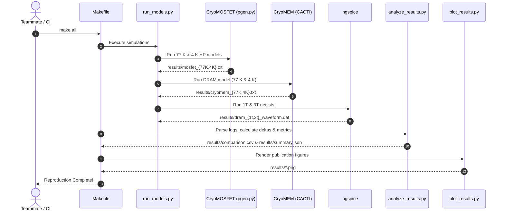

# CryoDRAM System & Repository Architecture

## 1. Directory Structure

```
cryogenic-dram-project/
├── configs/
│   └── DRAM.cfg                  # CACTI 3D DRAM memory configuration (32nm, 8Gb)
├── docs/
│   ├── methodology.md            # Semiconductor physics and modeling methodology
│   ├── architecture.md           # Architecture diagrams and system flow
│   ├── results-and-limitations.md # Verified results and critical limitations
│   ├── troubleshooting.md        # Comprehensive troubleshooting guide
│   └── references.md             # Academic paper citations and references
├── results/
│   ├── README.md                 # Data dictionary and regeneration guide
│   ├── comparison.csv            # Tabular 77 K vs 4 K comparison
│   ├── summary.json              # Full structured metrics with metadata
│   ├── mosfet_77K.txt / 4K.txt   # Raw CryoMOSFET generator outputs
│   ├── cryomem_77K.txt / 4K.txt  # Raw CryoMEM CACTI outputs
│   ├── dram_1t.log / 3t.log      # SPICE simulation logs
│   ├── dram_1t_waveform.dat      # 1T-1C transient waveform trace
│   ├── dram_3t_waveform.dat      # 3T transient waveform trace
│   └── *.png                     # Generated figures
├── scripts/
│   ├── setup.sh                  # One-step environment setup & dependency build
│   ├── run_all.sh                # End-to-end simulation runner
│   └── clean_outputs.sh          # Safe output cleaner
├── spice/
│   ├── dram_1t.sp                # Portable ngspice netlist for 1T-1C cell
│   ├── dram_3t.sp                # Portable ngspice netlist for 3T cell
│   └── nmos_generic.inc          # Generic Level-1 NMOS model card
├── src/
│   └── cryodram/
│       ├── __init__.py           # Package declaration & version
│       ├── run_models.py         # Subprocess runner for all models
│       ├── analyze_results.py    # Numerical extraction & CSV/JSON export
│       └── plot_results.py       # Automated matplotlib figure generator
├── tests/
│   ├── test_parsing.py           # Unit tests for text & waveform parsing
│   ├── test_calculations.py      # Unit tests for deltas & analytical models
│   ├── test_output_validation.py # Schema & file existence tests
│   └── test_smoke.py             # End-to-end pipeline smoke tests
├── third_party/
│   └── README.md                 # Upstream citations, licenses, and patches
├── CryoModel/                    # Upstream CryoModel repository (SNU-HPCS)
├── 1T-and-3T-DRAM-using-Cadence/ # Upstream circuit design project (srivastavadi)
├── Makefile                      # Top-level workflow targets
├── requirements.txt              # Pinned Python dependencies
├── pyproject.toml                # Project packaging configuration
├── CITATION.cff                  # Citation metadata
├── LICENSE                       # MIT License with upstream attributions
└── README.md                     # Main entrypoint documentation
```

---

## 2. Data Flow and Component Interactions


