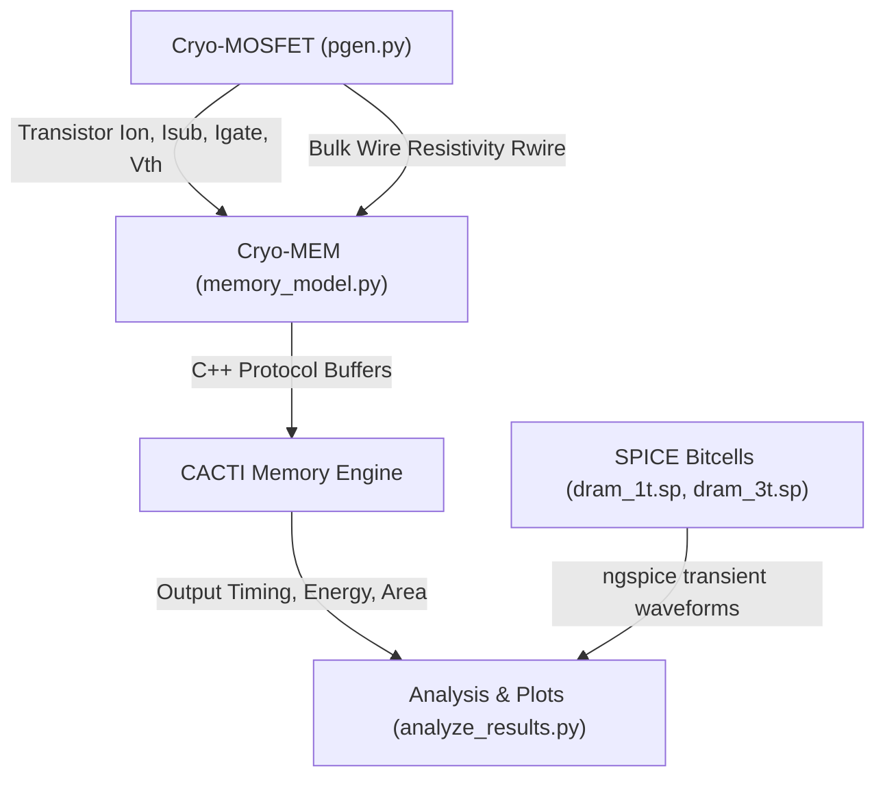

# CryoDRAM Research Methodology

## 1. Overview and Scientific Motivation
Cryogenic computing (operating at liquid nitrogen temperature, 77 K, and liquid helium temperature, 4 K) is an enabling technology for superconducting quantum computing control interfaces, cryogenic high-performance computing (HPC), and deep-space electronics.

At extreme low temperatures, semiconductor transport physics change dramatically:
1. **Carrier Mobility Enhancement**: Phonon scattering is suppressed, leading to increased electron and hole drift mobilities and higher on-current ($I_{on}$).
2. **Subthreshold Slope Steepening**: The thermal voltage $V_t = \frac{kT}{q}$ decreases from $\approx 25.9\text{ mV}$ at 300 K to $\approx 6.6\text{ mV}$ at 77 K and $\approx 0.34\text{ mV}$ at 4 K. Consequently, the subthreshold swing $SS = \ln(10) \cdot \frac{kT}{q} \cdot \left(1 + \frac{C_d}{C_{ox}}\right)$ drops sharply, resulting in orders-of-magnitude reduction in subthreshold leakage current ($I_{sub}$).
3. **Threshold Voltage Shift**: Bandgap widening and Fermi level shifts increase the threshold voltage $V_{th}$.
4. **Interconnect Resistivity**: Reduced phonon scattering lowers the bulk resistivity of copper interconnects ($R_{wire}$) by $\approx 8\times$ at 77 K and $\approx 8.7\times$ at 4 K.

---

## 2. CryoModel Modeling Layers

The repository implements a hierarchical evaluation framework combining device, interconnect, and memory array levels:

### 2.1 Cryo-MOSFET Device Model
- **Input Parameters**: Technology node (32 nm), target temperature (77 K or 4 K), supply voltage $V_{DD} = 1.2\text{ V}$, threshold voltage $V_{th0} = 0.4\text{ V}$.
- **Drive Current Formulation**: Models mobility enhancement and velocity saturation at low temperatures.
- **Leakage Current Formulation**: Combines band-to-band tunneling (BTBT), gate dielectric tunneling ($I_{gate}$), and subthreshold conduction.

### 2.2 Cryo-MEM Array Model (CACTI Integration)
- Connects device and interconnect parameters to an adapted CACTI 7.0 engine via Google Protocol Buffers (`pgen_interface.proto` and `cacti_interface.proto`).
- Optimizes bank organization (Ndwl, Ndbl, subarray sizing) for 8 Gb 3D/2D DRAM.
- Evaluates access latency components ($t_{RCD}, t_{RAS}, t_{RC}, t_{CAS}, t_{RP}, t_{RRD}$), energy per operation (Activation, Read, Write, Precharge), standby leakage, and die area.

---

## 3. DRAM Bitcell Circuit Modeling (SPICE)

To evaluate bitcell mechanics, two classic dynamic memory cells are modeled in ngspice:

### 3.1 1T-1C DRAM Cell
- **Topology**: 1 access NMOS transistor ($W = 2\ \mu\text{m}, L = 0.18\ \mu\text{m}$) and 1 dedicated trench/stack storage capacitor ($C_s = 1\text{ pF}$).
- **Operation**:
  - **Write `1`**: Wordline pulses to $V_{DD} = 5.0\text{ V}$. The storage node charges through the NMOS pass transistor. Because the gate is at $V_{DD}$, the source voltage cannot exceed $V_{DD} - V_{th}$, incurring a threshold drop:
    $$V_{store} \approx V_{DD} - V_{th} \approx 4.05\text{ V}$$
  - **Read Operation**: Destructive charge sharing between storage capacitor $C_s$ and precharged bitline capacitance $C_{BL}$:
    $$\Delta V_{BL} = \frac{C_s}{C_s + C_{BL}} (V_{store} - V_{BL,pre})$$
    Requires sensitive differential sense amplifiers and rewrite/refresh cycles.

### 3.2 3T Gain Cell DRAM
- **Topology**: 3 NMOS transistors (M0 write access, M1 storage/amplification, M2 read access). Storage capacitance is the parasitic gate capacitance ($C_s \approx 2\text{ fF}$).
- **Operation**:
  - **Write**: Charges storage node $SN$.
  - **Read**: Read line $RL$ pulses high. Read bitline $BBL$ discharges through M2 and M1 if node $SN$ holds a `1`.
  - **Advantage**: Non-destructive read with full-rail bitline swing, eliminating the need for analog sense amplifiers.
  - **Trade-off**: Requires ~3× cell area.
